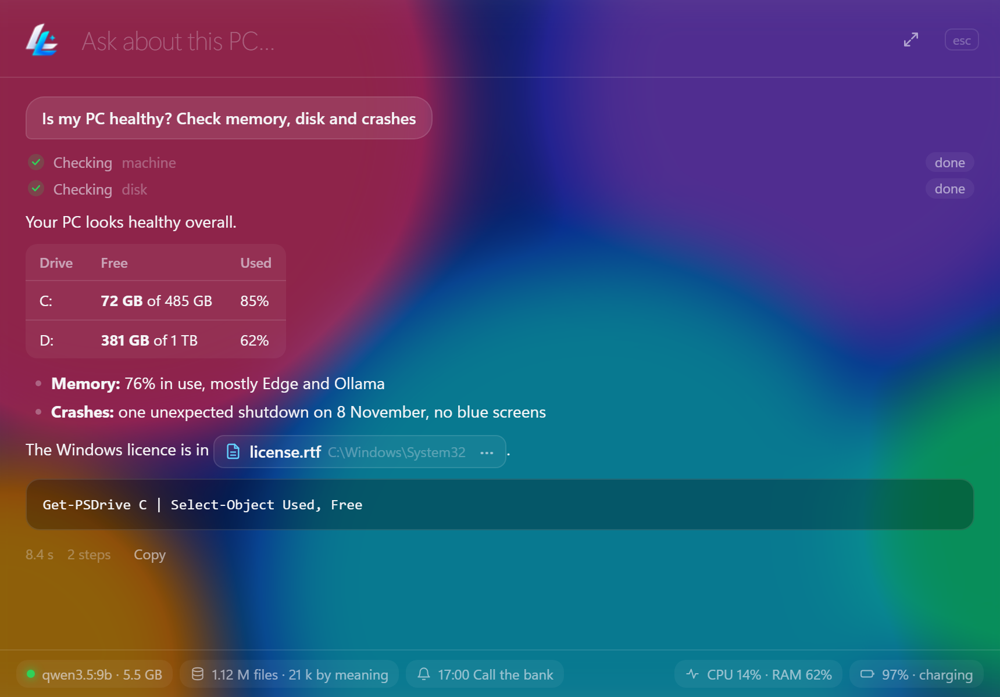
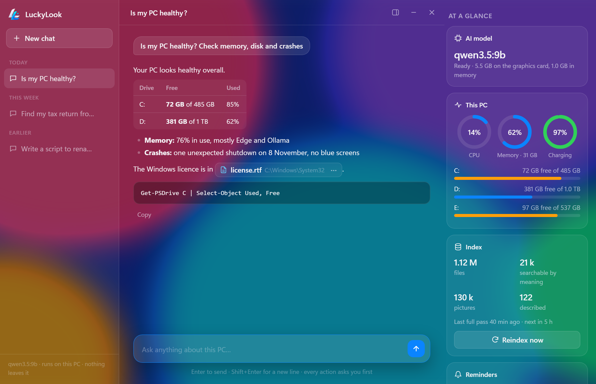
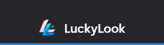

# LuckyLook


**A private AI for your Windows PC that knows what's on it.** Press **Ctrl+Alt+L** anywhere (or click the thin blue tab hanging from the top of your screen), ask a question, and it answers from your own computer:



For longer conversations there's the **LuckyLook app**: your chats on the left, the answers in the middle, and *At a glance* on the right (the AI model, CPU, memory, battery, drives, the index and your reminders):





- **Files and documents:** "where is my resume?", "what did I quote the client for the logo?", "what's eating my disk?". Searches inside documents, PDFs, Word, PowerPoint and Excel files (old `.doc`/`.xls`/`.ppt` too), notes, code and zips (the names of the files in them), and your pictures: while you're away from the PC, the model describes each photo, screenshot and scan and copies its text, so "the photo of my car" finds it. All by exact words *and by meaning*: "the bill from the plumber" finds the invoice even if it never says "bill".
- **Your PC:** free space, installed apps, what's using memory, battery, specs.
- **What you were doing:** recently opened files, and websites you visited (Edge and Chrome history).
- **What's on your screen:** "what does this error mean?" It looks at your screen. Also images and photos ("what does this receipt say?").
- **What you copied:** text, files, or a Win+Shift+S snip.
- **Does things, if you allow it:** "open my resume", "start Blender", "close Chrome", "play Shape of You" (plays the top YouTube result in Edge), "make a Taxes 2026 folder", "write a Python script in it that adds up my invoices", "run it", "change the port in config.py to 8080", "move the invoices into it", "delete the old installer". Every action shows **Allow / Deny** first, with the exact command or change, and deleting only ever goes to the Recycle Bin.
- **Reminders:** "remind me at 5 pm to call the bank" pops up a Windows notification then.
- **When something's wrong:** "why did my PC crash last night?" (shutdowns, blue screens, app crashes), "what starts with Windows?"
- **Remembers you:** "remember that I prefer short answers" goes into `memory.md`. Tell it about yourself in `me.md` (tray menu › About me…). Your conversation is still there after a restart; `/new` starts fresh.

Everything runs **on your computer** with [Ollama](https://ollama.com). No cloud, no account, nothing leaves the machine.

The popup is frosted glass in the style of macOS Spotlight, and it opens on the screen your mouse is on. While it works, a soft rainbow glow runs round its edge and each step shows as it happens ("Searching inside your files… 12 found"); answers stream in word by word. Files and folders in answers are chips: click to open, ⋯ or right-click to show in Explorer (programs only ever show in Explorer, a click never runs them). Code has a Copy button, and so does every answer. The strip at the bottom shows the AI model, the index, your next reminder, CPU, memory and battery.

Open the app from the tray menu (**Open LuckyLook app**), the Start menu, or ⤢ in the popup.

## Requirements

- Windows 11 (Windows 10 works, just without rounded corners). The windows are drawn by the web view built into Windows (WebView2, the same engine as Edge).
- [Python](https://www.python.org/downloads/) 3.10 or newer, and [Ollama](https://ollama.com/download). The installer sets these up for you if they're missing.
- Any PC with 4 GB of RAM or more. LuckyLook picks the AI model that fits your hardware (see `models.json`): a graphics card with 8 GB gets the recommended `qwen3.5:9b`, a bigger card gets a bigger model, and smaller cards or PCs without one get a smaller model that runs on the CPU.

## Install (easy way)

1. On this page, click **Code › Download ZIP**, then unzip it somewhere permanent (for example `Documents\LuckyLook`).
2. Double-click **`install.bat`**.

It checks for Python and Ollama and installs them with winget if they're missing. It then downloads the AI models (several GB, one time only), sets everything up, runs a self-check, adds LuckyLook to Windows startup and starts it. Don't want it to start with Windows? Run `install.bat -NoStartup`.

## Install (by hand)

In a terminal:

```
git clone https://github.com/SathyaMaragani/LuckyLook
cd LuckyLook
ollama pull qwen3.5:9b
ollama pull nomic-embed-text
python -m venv .venv
.venv\Scripts\pip install -r requirements.txt
.venv\Scripts\python test_lucky.py
.venv\Scripts\pythonw lucky.py
```

(`qwen3.5:9b` is for an 8 GB graphics card. With a different PC, pull the model `models.json` lists for it instead; `install.bat` does this for you.)

LuckyLook now runs in the background: press **Ctrl+Alt+L**. The first time, it indexes every fixed drive, and that can take an hour or more on a big disk. The strip at the bottom of the popup shows progress, and you can ask questions meanwhile. After that it refreshes every 6 hours (counted from the last time, so restarting doesn't redo it), and only re-reads files that changed. To pick up new files right away: tray menu › **Reindex now**. If you'd rather have changes show up within seconds, set `LIVE = True` in `local_settings.py`; that keeps a small background job running, which you may notice on battery. Search by meaning builds up in the background too, at about 20 documents a second with a graphics card.

Optional: copy `me.example.md` to `me.md` and tell it about yourself (your name, your work, where your projects live).

**Start with Windows:** run this in PowerShell from the LuckyLook folder:

```powershell
$s = (New-Object -ComObject WScript.Shell).CreateShortcut("$([Environment]::GetFolderPath('Startup'))\LuckyLook.lnk"); $s.TargetPath = "$PWD\.venv\Scripts\pythonw.exe"; $s.Arguments = "`"$PWD\lucky.py`""; $s.WorkingDirectory = "$PWD"; $s.IconLocation = "$PWD\assets\logo.ico"; $s.Save()
```

## Using it

| | |
|---|---|
| **Ctrl+Alt+L**, click the top tab, or click the tray icon | open or close the popup |
| tray menu › **Open LuckyLook app**, the Start menu, or ⤢ in the popup | the app window: chats and *At a glance* |
| right-click the tray icon | menu: open, open the app, show or hide the top tab, **Reindex now**, **About me…**, **Private folders and windows…**, **Change hotkey…**, restart, quit |
| **Enter** / **Esc** | ask / hide (in the app, **Shift+Enter** is a new line) |
| ■ while it answers | stop the answer |
| `/new` | start a fresh conversation |
| `/widget` | hide or show the top tab |
| `/quit` | close LuckyLook |

The top tab gets out of the way by itself during full-screen videos, games and slideshows.

## Privacy

- Nothing is sent anywhere. The model, the index (`index.db`) and your notes all stay in this folder.
- It reads file *names* everywhere on your fixed drives, and the *text* of documents and code outside system folders. Secrets files (`.env`, SSH keys, `.pem`/`.key`/`.pfx`, KeePass databases) are never read. OneDrive files that live only in the cloud are not downloaded.
- It only looks at your screen, clipboard or browser history when you ask a question that needs them. LuckyLook's own windows never appear in screenshots or screen shares (that's also how their glass sees what's behind them).
- It never changes anything without asking: opening, starting and closing apps, opening websites, creating folders, writing and editing files, running commands, moving and deleting each wait for your **Allow**. It shows you what it will write, change or run first. Deleting goes to the Recycle Bin, writing over or editing a file sends the old version there too, and moving never overwrites. Commands that name a private folder are refused, but a command can reach anything you can, so read it before you allow it.
- Websites open in your Edge profile set by `EDGE_PROFILE` (default `Default`), never a private one. To play a song or video, LuckyLook itself looks up YouTube's top result for what you asked (after your Allow, without cookies or any account); that search is the one thing it sends out.
- **Keep things out:** tray menu › **Private folders and windows…** (or copy `local_settings.example.py` to `local_settings.py`). List folders LuckyLook must never touch (for example a browser profile), and window titles to black out whenever it looks at your screen. To keep browsing history out entirely, add `HISTORY = []`. Then tray menu › Restart LuckyLook.

## Settings

Put overrides in `local_settings.py`: `HOTKEY`, `MODEL`, `ROOTS` (which drives to index), `REINDEX_HOURS`, `LIVE`, `EDGE_PROFILE`, `PRIVATE`, `PRIVATE_WINDOWS`, `HISTORY`. Restart LuckyLook from the tray menu afterwards. Other constants are at the top of each file: `lucky.py` has the look and the re-index timings.

**Memory:** LuckyLook itself uses about 270 MB of RAM (its windows are drawn by Windows' web view), about 400 MB while the app window is open, and around 1% of one CPU core when idle. The AI model uses about 5.5 GB of graphics memory while answering, and Ollama unloads it after 5 minutes without questions. The installer also sets `OLLAMA_FLASH_ATTENTION=1` and `OLLAMA_KV_CACHE_TYPE=q8_0`, which halve the memory the model needs for the conversation (512 → 272 MB at LuckyLook's 16k context); they apply from Ollama's next start.

**Which model:** `models.json` maps hardware to a model: by graphics card memory, or by RAM when there's no usable card. Edit it to change the choices for everyone; set `MODEL` in `local_settings.py` to force one on your own PC. To see what your PC gets: `.venv\Scripts\python -c "import agent; print(agent.specs(), agent.MODEL)"`. Any Ollama model with tool calling works. For screen and image questions, it also needs vision. `bench.py` compares models on questions about your PC: `.venv\Scripts\python bench.py qwen3.5:9b qwen3:8b --think`.

## Files

- `lucky.py`: the popup, the app window, the top tab, the hotkey and tray, and keeping the index fresh. Errors go to `lucky.log`.
- `ui/`: how the windows look (`style.css`), the conversation (`chat.js`), and the popup, app and tab pages. Plain files, nothing loaded from the internet.
- `agent.py`: the model and its tools. Also usable from a terminal: `.venv\Scripts\python agent.py "where is my resume?"`
- `indexer.py`: builds `index.db`. Run it by hand for a folder: `.venv\Scripts\python indexer.py D:\Projects`
- `install.bat` / `install.ps1`: the one-click installer. Safe to run again: it skips what's already done.
- `models.json`: which AI model fits which hardware.
- `test_lucky.py`: self-check. `bench.py`: model comparison. `assets/`: the logo and screenshots.

## License

MIT. See [LICENSE](LICENSE).
